<div align="center">
  
  <h1>CFIC · Showcase</h1>
  <p><strong>Do primeiro interesse à matrícula, com uma visão completa do atendimento.</strong></p>
  <p>Inscrições · Gestão comercial · Caderno digital · Indicadores</p>
  <p><a href="https://jonaspessoa.github.io/cfic-showcase/">Abrir demonstração</a> · <a href="https://jonaspessoa.github.io/cfic-showcase/#painel">Testar o painel</a> · <a href="#galeria">Ver as telas</a> · <a href="docs/ARQUITETURA.md">Arquitetura</a></p>
</div>


## O projeto

O sistema CFIC conecta a experiência de inscrição do aluno ao atendimento comercial. A equipe acompanha comprovantes, pagamentos conferidos, contratos e contatos de Instrumentação Cirúrgica em painéis organizados.

O projeto nasceu de uma operação com anotações em cadernos manuscritos e evoluiu para uma aplicação com cadastro estruturado, histórico de atendimento, sincronização e indicadores. A proposta é preservar o contexto de cada interessado e dar clareza ao próximo passo da matrícula.

**Este repositório é a apresentação pública do produto e contém uma demo independente.** O código do backend, o banco de produção, as credenciais da equipe e os dados de alunos não são distribuídos aqui.

## Teste agora

**[Abrir o painel demonstrativo →](https://jonaspessoa.github.io/cfic-showcase/#painel)**

| Acesso público da demo | Valor |
| --- | --- |
| Login | `demo@cfic.example` |
| Senha | `CFICdemo2026!` |

Esse login é ilustrativo e validado no navegador; ele não autentica no sistema real. Os exemplos usam nomes fictícios, e-mails de exemplo e telefones deliberadamente inválidos. Não insira dados pessoais reais.

### Um roteiro de três minutos

1. Entre com as credenciais acima e explore a **Visão geral**.
2. Abra **Contatos**, busque por `fabio`, filtre situações e edite uma ficha.
3. Exporte os resultados em **CSV** ou **JSON**.
4. Em **Inscrição**, mantenha os exemplos fictícios, aceite o aviso e conclua o envio simulado do comprovante.
5. Veja a nova inscrição em **Comercial** e mude a etapa para pagamento confirmado ou contrato enviado.
6. Volte à **Visão geral** para ver os indicadores atualizados e o histórico das suas ações.
7. Em **Quem recebeu**, examine exemplos de interesse positivo, resultado incerto e número indisponível.
8. Use **Restaurar demo** para recomeçar com os exemplos iniciais.

As alterações são salvas no `localStorage` deste navegador. A sessão demo usa `sessionStorage`. Visitantes não compartilham alterações entre si. Limpar os dados do site ou usar Restaurar demo remove as simulações locais; sair encerra apenas a sessão.

## O que o produto resolve

| Jornada | Experiência |
| --- | --- |
| Aluno | Campanha temática, inscrição, orientação de Pix e envio de comprovante |
| Comercial | Conferência humana do pagamento, acompanhamento do contrato e das etapas da matrícula |
| Atendimento | Contatos organizados por situação, observações e histórico |
| Gestão | Dashboard, atividade de atendimento, resultados, filtros e exportações |
| Integração | Caderno sincronizado ao banco e visibilidade do atendimento por WhatsApp |

O foco atual das telas de gestão é **Instrumentação Cirúrgica**. O pagamento do produto real é Pix com conferência humana: anexar um comprovante não confirma automaticamente o pagamento.

## Demo e produto real

| Recurso | Demo pública deste repositório | Produto em operação |
| --- | --- | --- |
| Login | Credenciais ilustrativas públicas | Autenticação e autorização da equipe |
| Contatos | 12 exemplos fictícios editáveis | Dados privados no Supabase |
| Dashboard | Indicadores dos exemplos e série de atividade ilustrativa | Indicadores calculados sobre os dados do sistema |
| Inscrição | Cadastro local de uma pessoa fictícia | Registro persistente do aluno |
| Comprovante | Simulação e arquivo `.txt` sem validade | Upload privado com consulta autenticada |
| Pagamento | Mudança local da etapa | Conferência humana do Pix |
| Contrato | Etapa comercial demonstrativa | Acompanhamento do envio e retorno pelo comercial |
| WhatsApp | Histórico fictício, sem chamadas de rede | Integração local com OpenWA e sincronização |
| Exportação | Download de contatos fictícios filtrados | Exportações autenticadas do Caderno |
| Armazenamento | Somente neste navegador | Banco e armazenamento privados |

## Galeria

**14 capturas reais de interface**, feitas em 05/11/2026. As primeiras cinco mostram o produto; as nove seguintes mostram a demo. Não são montagens. Os contadores são retratos das capturas e não indicadores em tempo real.

### Produto · campanha e inscrição

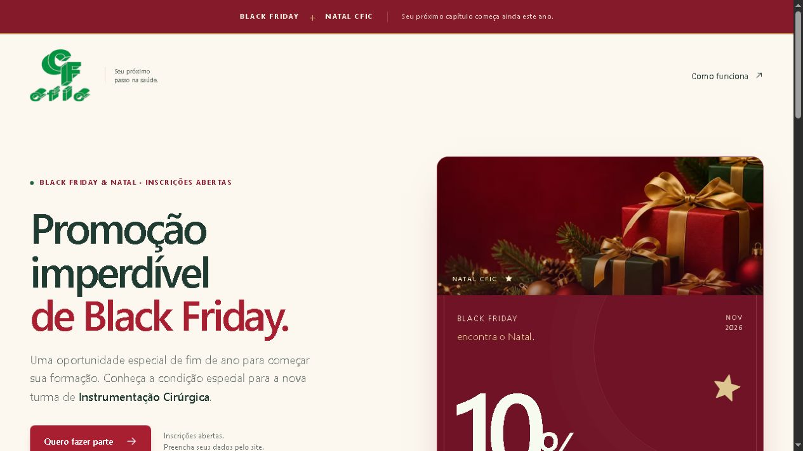

<details>
<summary>Formulário público de inscrição</summary>

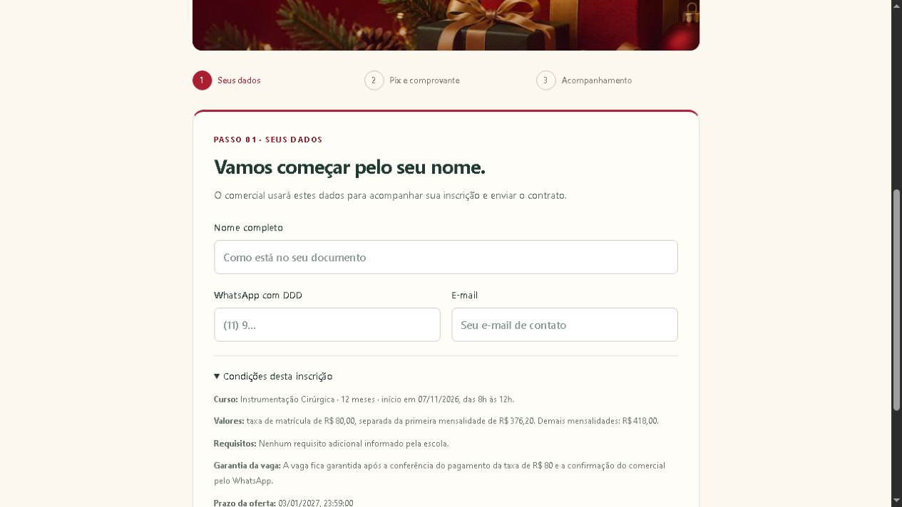

</details>

### Produto · gestão e indicadores

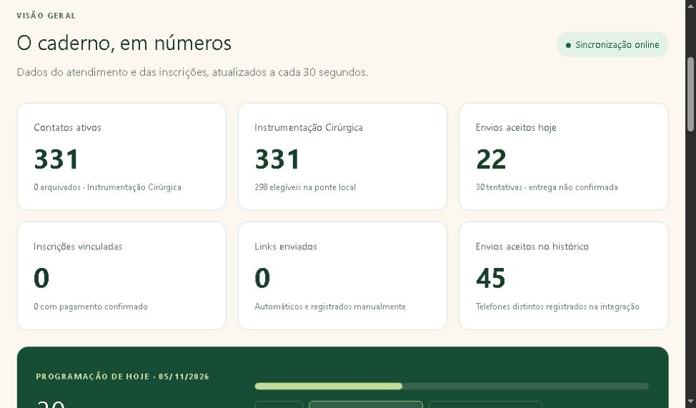

<details>
<summary>Gráficos de envios e resultados</summary>

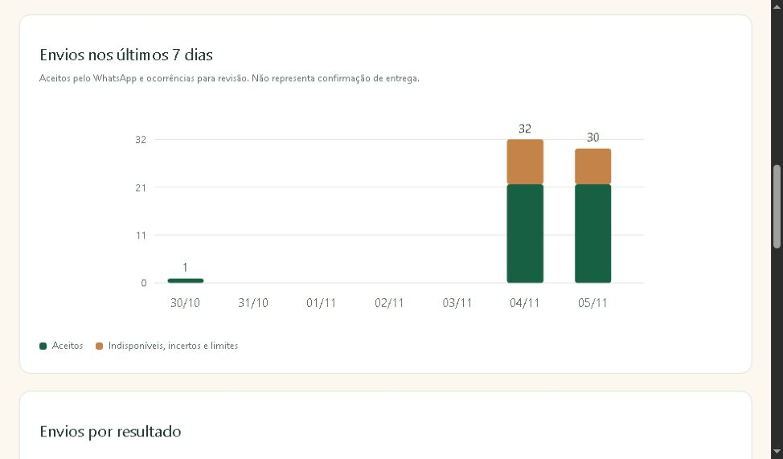

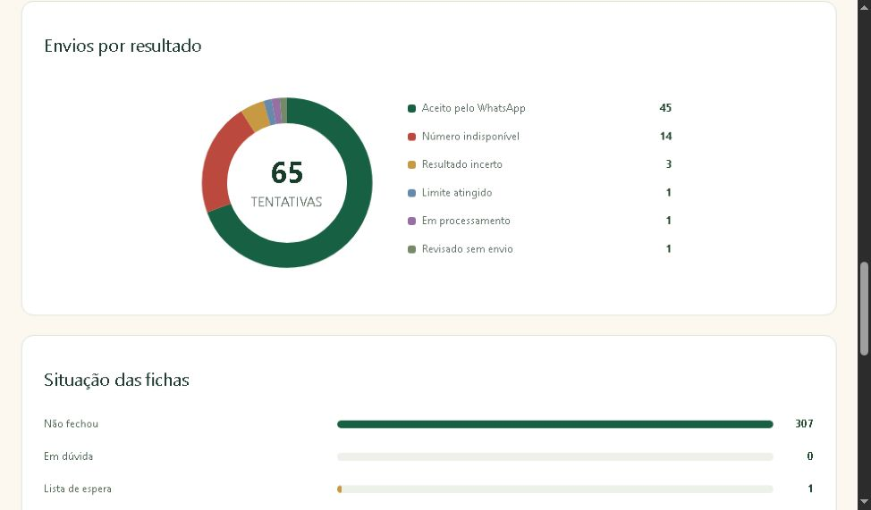

</details>

### Demo · acesso e gestão

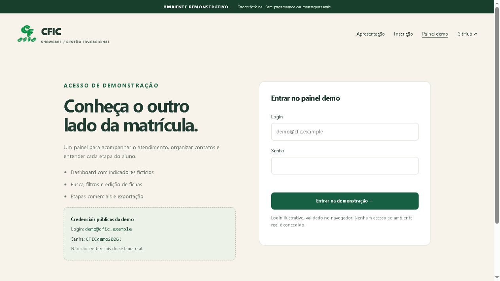

<details>
<summary>Dashboard e contatos fictícios</summary>

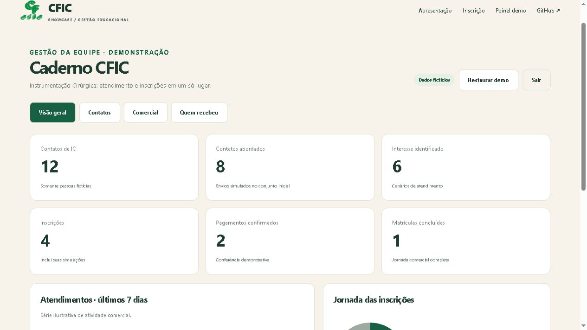

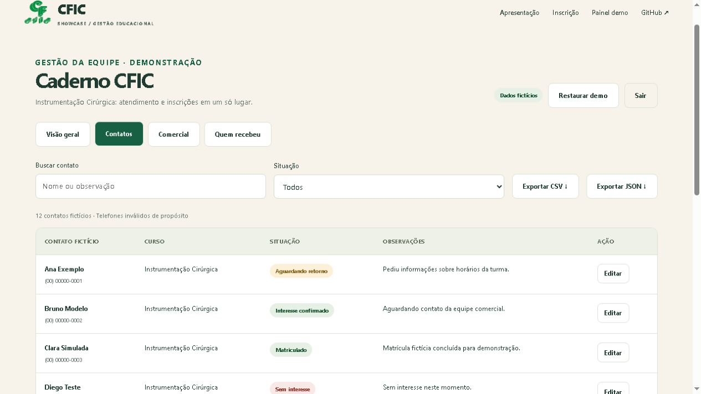

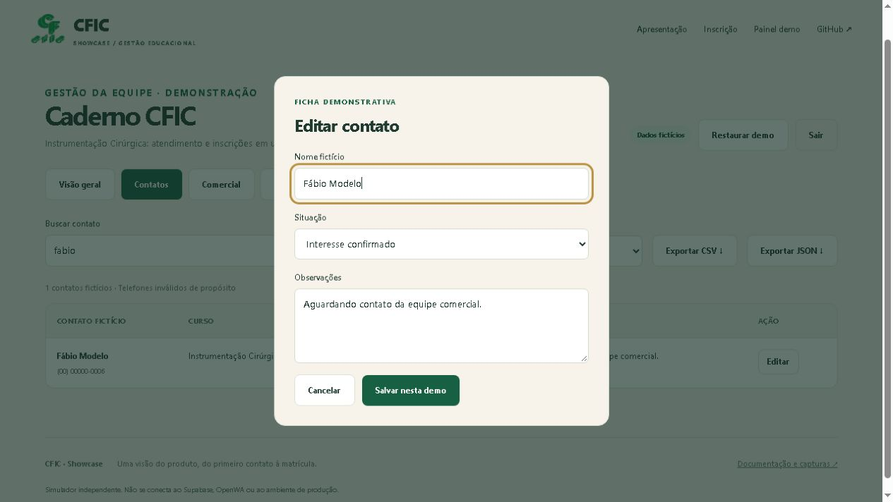

</details>

### Demo · comercial e atendimento

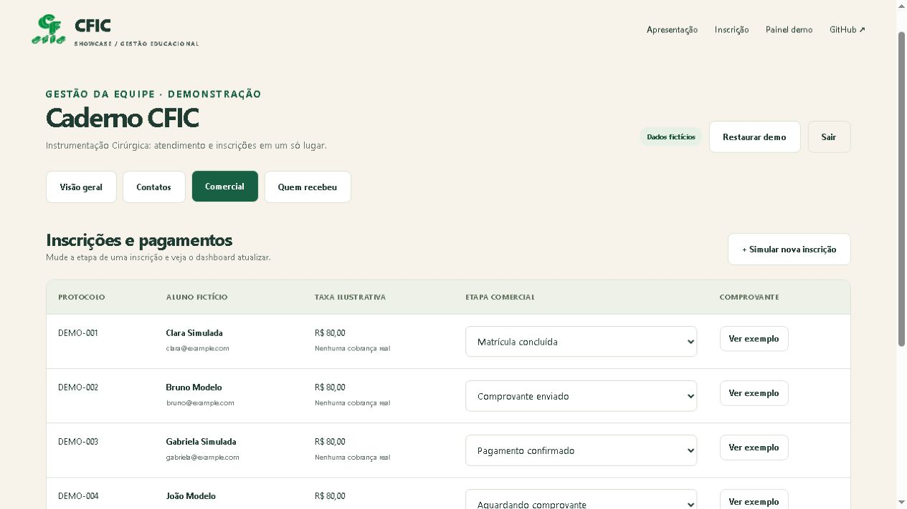

<details>
<summary>Histórico fictício de atendimento</summary>

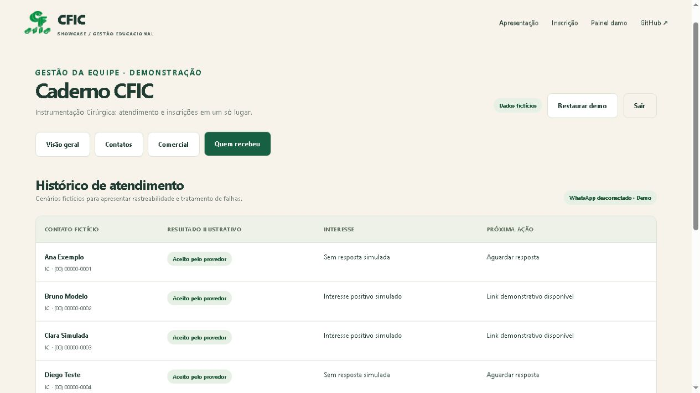

</details>

### Demo · jornada do aluno

<details>
<summary>Formulário e conclusão da inscrição simulada</summary>

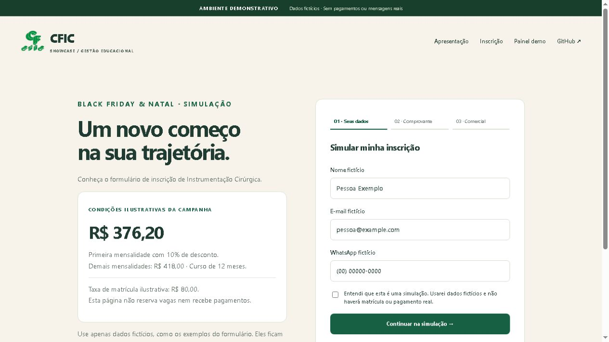

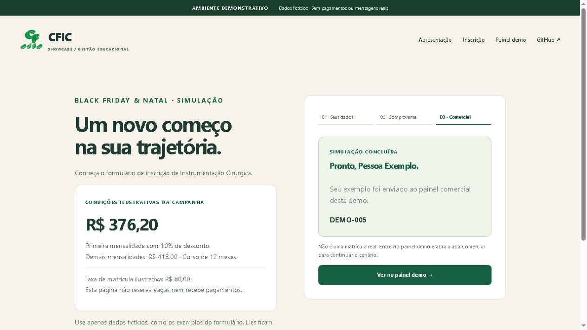

</details>

## Arquitetura do produto

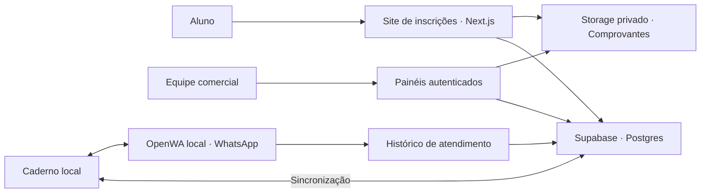

O site e os painéis usam **Next.js, React, TypeScript, Tailwind CSS e Motion**. O **Supabase** concentra autenticação, Postgres e arquivos privados; a **Vercel** hospeda a aplicação. O atendimento por OpenWA roda em serviço local separado, com histórico e sincronização do Caderno.

A demo deste repositório usa apenas **HTML, CSS e JavaScript**, publicada no **GitHub Pages**. Não utiliza banco, variáveis de ambiente ou credenciais de infraestrutura. Essa separação permite apresentar o fluxo sem abrir o sistema operacional a visitantes.

Leia os detalhes em [Arquitetura e decisões](docs/ARQUITETURA.md) e [Segurança da demonstração](SECURITY.md).

## Executar localmente

Requisitos: Python 3 para servir os arquivos; Node.js 20 ou superior para executar os testes. Não há dependências de execução para instalar.

```bash
git clone https://github.com/jonaspessoa/cfic-showcase.git
cd cfic-showcase
python -m http.server 4173 --bind 127.0.0.1
```

Abra [http://127.0.0.1:4173/](http://127.0.0.1:4173/). Use um servidor HTTP; abrir `index.html` por `file://` não é suportado por causa dos módulos JavaScript.

```bash
npm test
```

Os testes verificam credenciais demonstrativas, independência dos conjuntos de exemplo, busca com acentuação, filtros e segurança da serialização CSV. O fluxo de login, edição e inscrição também foi validado pelo navegador.

## Organização

```text
cfic-showcase/
├── index.html              # Estrutura, navegação e modal de edição
├── styles.css              # Identidade visual e layouts responsivos
├── app.js                  # Fluxos interativos e armazenamento local
├── data.js                 # Fixtures fictícias e funções testáveis
├── assets/                 # Logo CFIC e arte da campanha
├── docs/
│   ├── ARQUITETURA.md       # Produto, demo e decisões
│   └── screenshots/        # 14 capturas revisadas
├── tests/demo.test.js      # Testes com node:test
├── SECURITY.md             # Limites e cuidados da demo
└── .nojekyll               # Publicação estática no GitHub Pages
```

## Publicação e manutenção

O GitHub Pages publica a branch `main`, pasta `/ (root)`. Não há build de aplicação nem projeto Supabase a configurar. As referências a arquivos são relativas para funcionar sob `/cfic-showcase/`.

Ao atualizar o produto, revise a descrição dos recursos, recapture somente telas sem informações pessoais e mantenha as diferenças entre demo e produção explícitas. O [guia das capturas](docs/screenshots/README.md) registra a origem de cada print.

## Escopo e autoria visual

Este showcase apresenta um sistema desenvolvido para a CFIC. A identidade visual usa a marca fornecida pela escola e uma arte de campanha criada para o projeto. Marca, imagens e materiais institucionais pertencem aos respectivos titulares; a publicação deste repositório não concede autorização de uso da marca.

O código-fonte operacional, bancos de dados, contatos, comprovantes e credenciais não fazem parte deste showcase. A demonstração não oferece cobrança, assinatura de contrato, matrícula real ou envio de WhatsApp.
