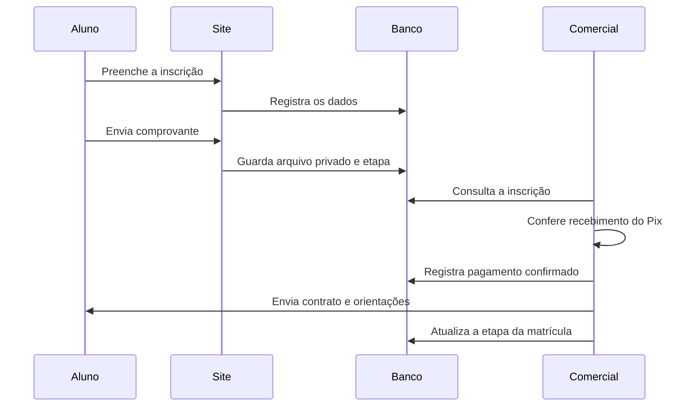
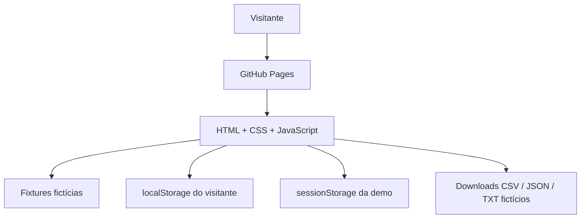

# Arquitetura e decisões

## Contexto

O produto organiza a captação de alunos e o atendimento comercial da CFIC, com foco atual em Instrumentação Cirúrgica. A origem dos contatos é um caderno manuscrito: digitalizar exige preservar observações, situações e evidências de origem, além de transformar as fichas em dados pesquisáveis.

## Jornada de negócio

O comprovante é evidência para conferência humana. Upload não equivale a confirmação bancária. O sistema acompanha etapas comerciais; não é um gateway ou uma plataforma de assinatura eletrônica.

## Componentes do produto

| Componente | Responsabilidade |
| --- | --- |
| Next.js / React / TypeScript | Interface e rotas do site e painéis |
| Tailwind / Motion | Estilo responsivo e movimento da campanha |
| Supabase Auth | Identidade da equipe |
| Postgres | Inscrições, histórico e Caderno |
| Storage privado | Comprovantes e arquivos de origem |
| Vercel | Hospedagem da aplicação |
| Caderno local | Organização, alterações e sincronização das fichas |
| OpenWA local | Operação da conexão com WhatsApp |

O serviço local e a aplicação web têm ciclos de execução distintos. A disponibilidade do site não significa que o WhatsApp esteja conectado. A gestão mostra informações da última sincronização para dar contexto ao operador.

## Indicadores e rastreabilidade

As telas combinam situações dos contatos, inscrições e histórico de atendimento. Resultados de envio precisam de interpretação: aceitação pelo provedor não comprova entrega ou leitura. Um resultado incerto exige revisão antes de qualquer repetição.

No produto, exportações e acesso às fichas pertencem ao fluxo autenticado. Dados dos outros cursos permanecem no banco quando as telas estão focadas em IC.

## Por que uma demo independente?

Uma credencial pública no painel operacional exporia dados e permitiria alterações em cadastros reais. A demo reproduz os principais fluxos de interação com um conjunto criado do zero e sem backend.

Não existe ligação de rede da demo com o banco, a Vercel operacional ou o WhatsApp. Os únicos acessos externos voluntários são links de navegação ao GitHub. O GitHub Pages fornece a hospedagem e pode registrar os acessos conforme sua própria política.

## Decisões da demo

- Sem dependências de execução: o visitante abre a página sem instalar ferramentas.
- Credenciais ilustrativas no cliente: oferecem a experiência visual do login, sem prometer autenticação real.
- Armazenamento por navegador: alterações não são compartilhadas entre visitantes.
- Exemplos restauráveis: um botão reconstrói o conjunto fictício inicial.
- Valores da campanha apenas ilustrativos: não há chave Pix, QR Code ou cobrança.
- Campos escapados antes de renderização; células CSV com prevenção de fórmulas.
- Layout responsivo, rótulos nos campos, foco visível, modal nativo e avisos de atualização acessíveis.

## Limites

A demo não testa autenticação do Supabase, políticas do banco, upload de arquivo, sincronização real ou disponibilidade de provedores. A série de atendimentos do gráfico é ilustrativa; métricas de contatos e inscrições refletem os exemplos locais. Inscrições demo não criam automaticamente uma ficha no Caderno demo.

Um fluxo que exija integração real deve usar ambiente próprio de homologação, com banco isolado e credenciais distintas do produto operacional.
